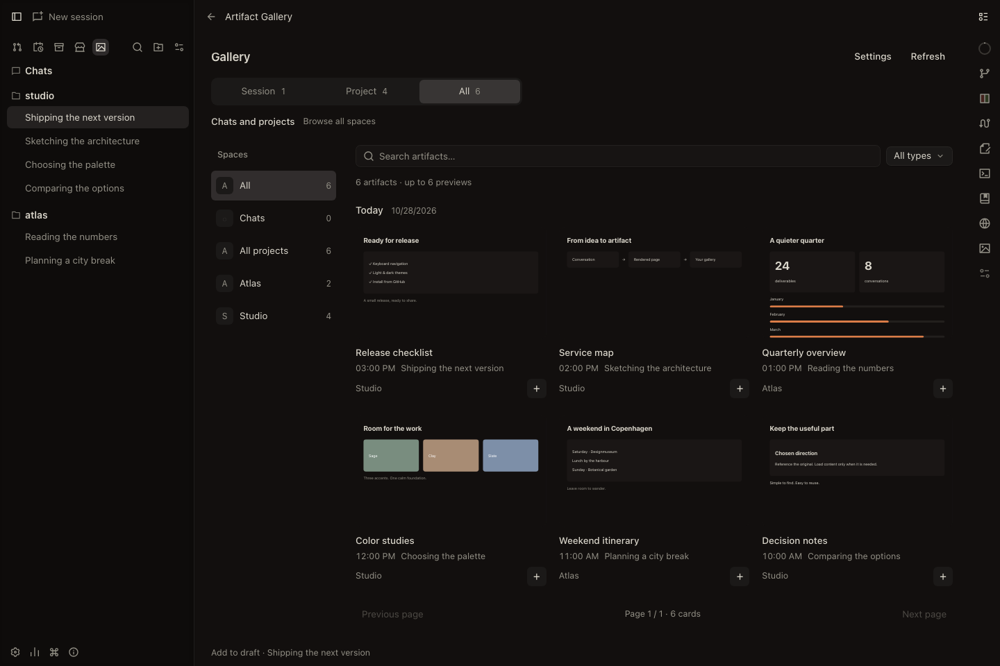
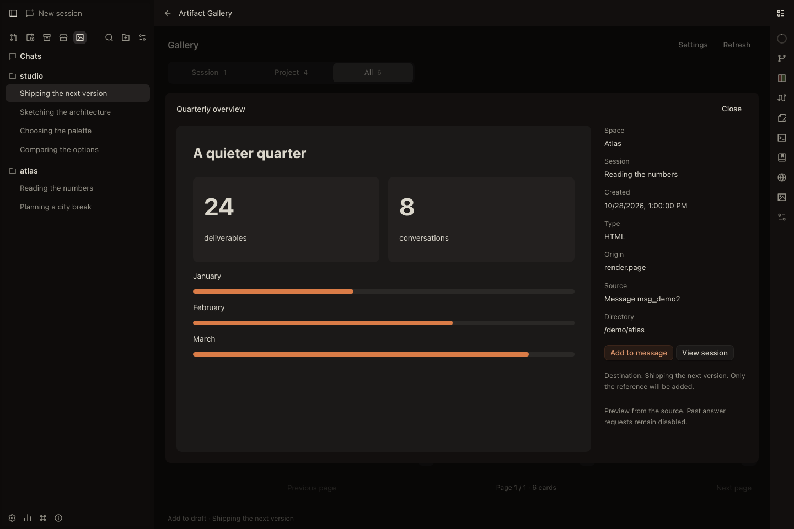
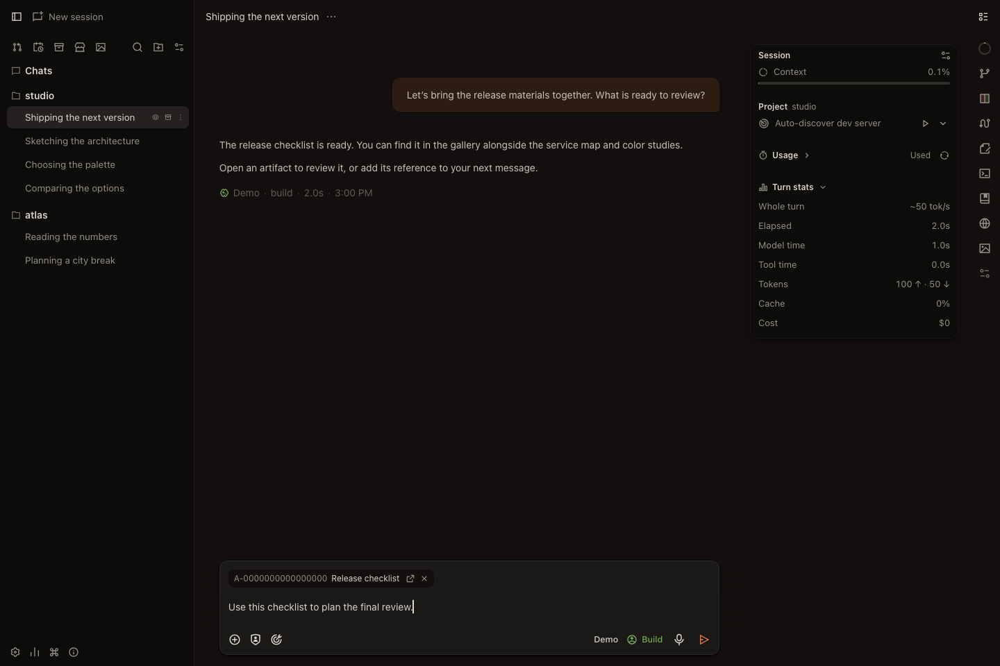

# Artifact Gallery for OpenChamber

**Find the useful thing your conversation made. Bring it into the next one.**

Inline pages, images, captures and deliverables, together in a contextual gallery.
Browse a session, its project, Chats or all your spaces. Preview the original and
add a lightweight reference to your current draft.

[Website](https://sofianbll.github.io/openchamber-artifact-gallery/) ·
[Install](docs/installation.md) ·
[Guide](docs/guide.md) · [Français](docs/fr/guide.md)



*The real OpenChamber 2.5.2 frontend and compiled extension, with synthetic APIs
and fictional projects. No private sessions are used in public screenshots.*

## A home for your artifacts

- **Stay in context.** Session follows your conversation. Project/Chats follows its
  space. All lets you explore without changing the destination of your draft.
- **See where it came from.** Dates, times, source files and original messages stay
  attached to every reference.
- **Reuse with a click.** Add to message inserts a provenance chip, without sending.
  Click the chip to reopen the artifact. Content is read only when requested.
- **Keep loading bounded.** 12 or 24 cards per page, at most six active thumbnails
  and two concurrent source reads. Offscreen previews unload.
- **Use your language.** English and French. Follow OpenChamber automatically, or
  choose a persistent extension preference.
- **Keep the familiar look.** Host colors, font stacks and corner radii, with
  OpenChamber's semantic text sizes and bundled Geist Sans. See the
  [appearance limits](docs/appearance.md).

Agents keep using `render.page`, file links and their usual presentation tools.
There is no extra publishing step, model call or automatic context injection.

## Install from GitHub

Requires a **local OpenChamber 2.5.2+** instance and a running OpenCode service
compatible with client **2.2.0**. Tested on macOS with OpenChamber 2.5.2.

1. Open **OpenChamber → Settings → Extensions → Add extension**.
2. Paste this repository URL:

   ```text
   https://github.com/sofianbll/openchamber-artifact-gallery
   ```

3. Review the **sessions** and **local service** capabilities, then install and
   enable **Artifact Gallery**.

Open the gallery from the **upper-left sidebar row, before search**. On narrow
sidebars, look under **Extension pages**. It is also available as a side panel.

**No Bun, npm install or build is needed.** OpenChamber clones the repository with
Git and supplies the Node runtime; both compiled entries ship in the repository.
Use the native extension update controls to follow new versions. Append `#v0.2.1`
to install that fixed tag instead.

[Full installation and update guide](docs/installation.md). A prebuilt `.tar.gz`
with SHA-256 is also available in [Releases](https://github.com/sofianbll/openchamber-artifact-gallery/releases/latest)
for folder installation.

> The local service runs with your user account's access. It reads session history
> and explicitly referenced files; it is not an OS sandbox. Previewed HTML runs
> in an isolated, network-blocked frame. The gallery index contains private metadata
> and stays on your machine. [Storage and boundaries](docs/privacy.md).

## See the whole flow

Open an original page with its source and date:



Add a reference to the active draft, without sending:



Switch themes or choose your language and preview preferences:


[Settings screenshot](docs/assets/host-settings.png) ·
[French interface](docs/assets/host-french.png) ·
[Narrow window](docs/assets/host-narrow.png)

The extension follows theme updates received from the host. **SDK 2.5.2 does not
send custom interface scale or padding**; those settings are not synchronized.
Nonbundled web fonts can fall back to an installed font. Font/radius-only host
changes may require reopening the gallery before the host sends updated tokens.

## Documentation

The [mini-doc](https://sofianbll.github.io/openchamber-artifact-gallery/guide.html)
has navigation and local search, in English and French:

- [Find an artifact](docs/browse.md)
- [Preview and reuse](docs/reuse.md)
- [Appearance and language](docs/appearance.md)
- [Privacy and limits](docs/privacy.md)
- [Troubleshooting](docs/troubleshooting.md)

## Develop

```sh
bun install --frozen-lockfile --ignore-scripts
bun test src/gallery.test.ts
bun run build
bun run docs:build
bun run package /absolute/path/to/new/openchamber-artifact-gallery-0.2.1
```

Install the built checkout by folder, or use the generated archive. Rebuild after
editing source, and commit both generated entries with the source change. For service
changes, disable and re-enable **Artifact Gallery**; there is
no need to restart the shared OpenCode service.

[Development and browser checks](docs/development.md) ·
[Architecture, limitations and measurements](docs/reference.md) ·
[Changelog](CHANGELOG.md)

## License & credits

[MIT](LICENSE). Independent community extension, not an official OpenChamber
release. Uses the official [OpenChamber SDK](https://github.com/openchamber/openchamber)
and its native HTML renderer. Vendored notices and source attribution are in
[`vendor/`](vendor/README.md); Geist Sans is licensed under the [SIL OFL](assets/LICENSE).
