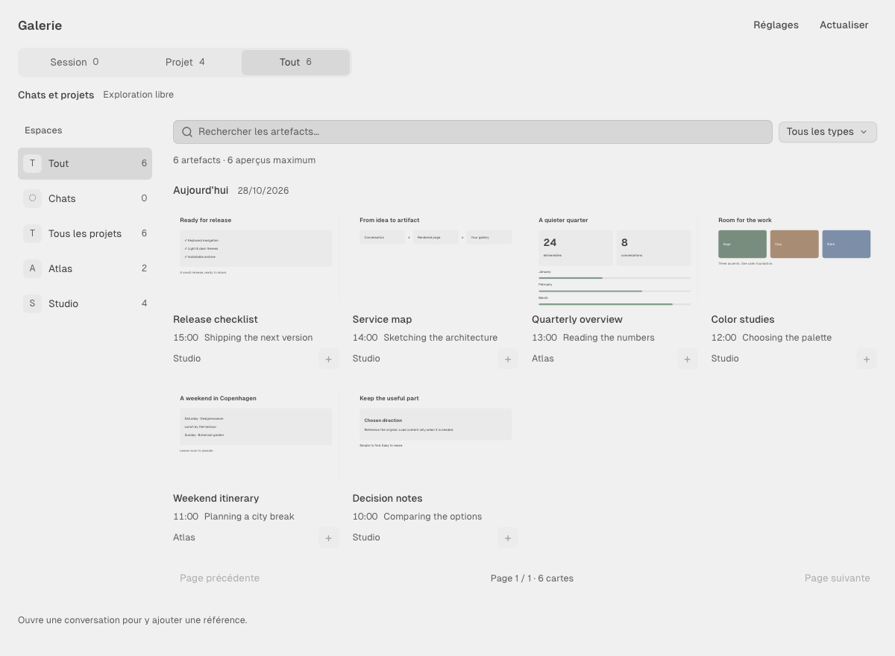

# Galerie d’artefacts pour OpenChamber

Retrouve les pages, images, captures et livrables de tes conversations, puis ajoute
leur référence au brouillon actif. Les agents utilisent leurs outils habituels.

[Site](https://sofianbll.github.io/openchamber-artifact-gallery/) ·
[Télécharger](https://github.com/sofianbll/openchamber-artifact-gallery/releases/latest) ·
[Guide technique en anglais](guide.md)

## Installation

1. Télécharge l’archive `.tar.gz` de la dernière release et décompresse-la dans un
   dossier permanent. Les archives automatiques « Source code » ne sont pas compilées.
2. Dans **OpenChamber → Réglages → Extensions → Ajouter une extension**, sélectionne
   ce dossier, vérifie les capacités **sessions** et **service local**, puis active **Galerie**.
3. Ouvre l’icône en haut à gauche, avant la recherche. Si la ligne manque de place,
   elle se trouve dans **Pages d’extensions**.

L’archive est prête à l’emploi : aucune installation npm ni compilation.
Version vérifiée : OpenChamber 2.5.2 local, service compatible OpenCode 2.2.0.
Le service local s’exécute avec les droits de ton compte utilisateur.

## Usage

- **Session** suit la conversation ; **Projet / Chats** suit son espace.
- **Tout** permet d’explorer sans changer la destination du brouillon.
- **Tous les projets** exclut Chats et les sources non classées.
- **Ajouter au message** insère une référence avec provenance, sans envoyer.
  La puce permet de rouvrir l’artefact.
- Les aperçus sont chargés à la demande : deux lectures simultanées, six vignettes
  actives maximum, pages de 12 ou 24 cartes.
- **Réglages → Langue** : Automatique suit OpenChamber ; English ou Français
  remplace ce choix et reste enregistré.

Les couleurs, polices et arrondis reçus suivent l’hôte. **Le SDK 2.5.2 ne transmet
pas l’échelle ni l’espacement personnalisés**. Certaines polices externes utilisent
une police de repli ; un changement de police seul peut nécessiter une réouverture.

L’index conserve des références privées sur la machine, pas les contenus. Les
fichiers ou messages supprimés deviennent indisponibles : la galerie n’est pas
une sauvegarde. Les pages HTML sont isolées et privées d’accès réseau.

Les captures publiques utilisent uniquement des données fictives. L’affichage
étroit a été vérifié dans Chromium ; cela ne vaut pas qualification mobile native.
