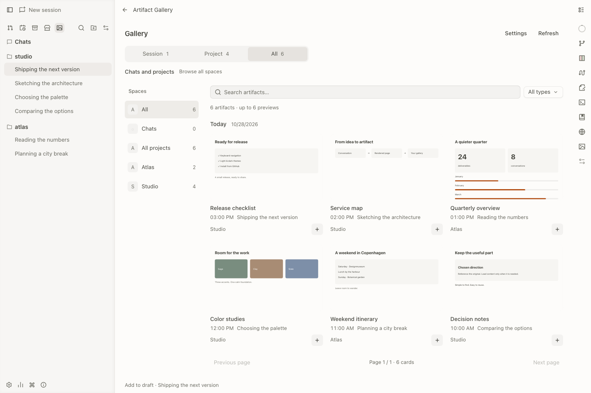
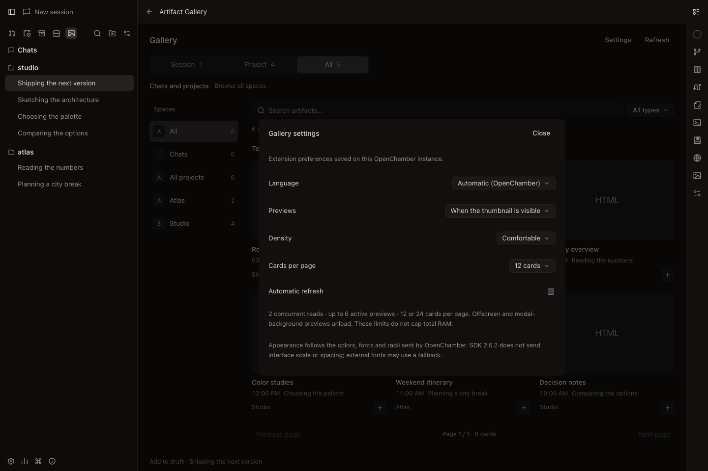
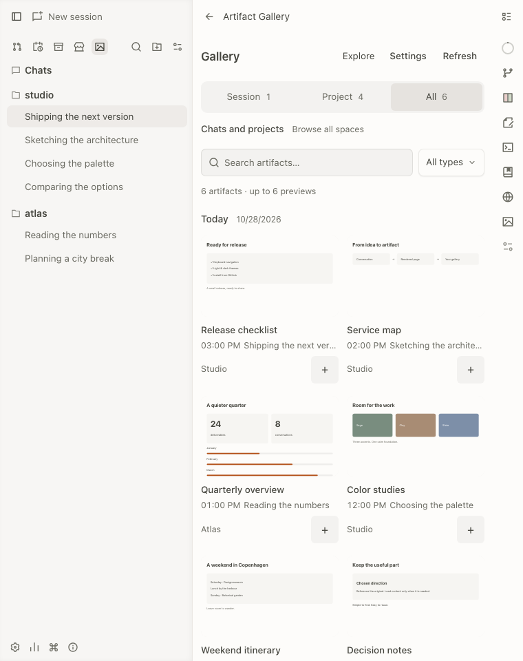

# Apparence et langue

## Suivre OpenChamber

La galerie suit le thème clair/sombre, les couleurs, la pile de polices et les
rayons reçus de l’hôte. Geist Sans est embarquée pour fonctionner hors ligne.
Les tailles de texte reprennent les tailles sémantiques par défaut d’OpenChamber.

::: info Limites du SDK 2.5.2
L’échelle d’interface et l’espacement personnalisés **ne sont pas transmis aux
extensions**. Un changement de police ou de rayon seul peut nécessiter de rouvrir
la galerie. Les polices web non embarquées peuvent utiliser une police de repli.
Une synchronisation complète nécessite une évolution de l’hôte et du SDK.
:::

## Choisir la langue

Dans **Réglages de la galerie → Langue** :

- **Automatique** suit OpenChamber : français pour une locale française, anglais sinon.
- **English** ou **Français** conserve une préférence prioritaire après rechargement.

Revenir à Automatique suit de nouveau l’hôte. Les titres et contenus utilisateur ne
sont pas traduits. L’entrée d’extension conserve le nom **Artifact Gallery**.
Le site public s’ouvre en anglais indépendamment de la langue de l’application.

## Régler les aperçus

Les réglages contrôlent aussi l’actualisation automatique, 12 ou 24 cartes par page
et les aperçus. **À l’ouverture uniquement** désactive les vignettes vivantes sans
empêcher l’aperçu détaillé.

La galerie s’adapte aux fenêtres étroites. Ces vérifications ne qualifient pas les
hôtes mobiles ou VS Code d’OpenChamber.

