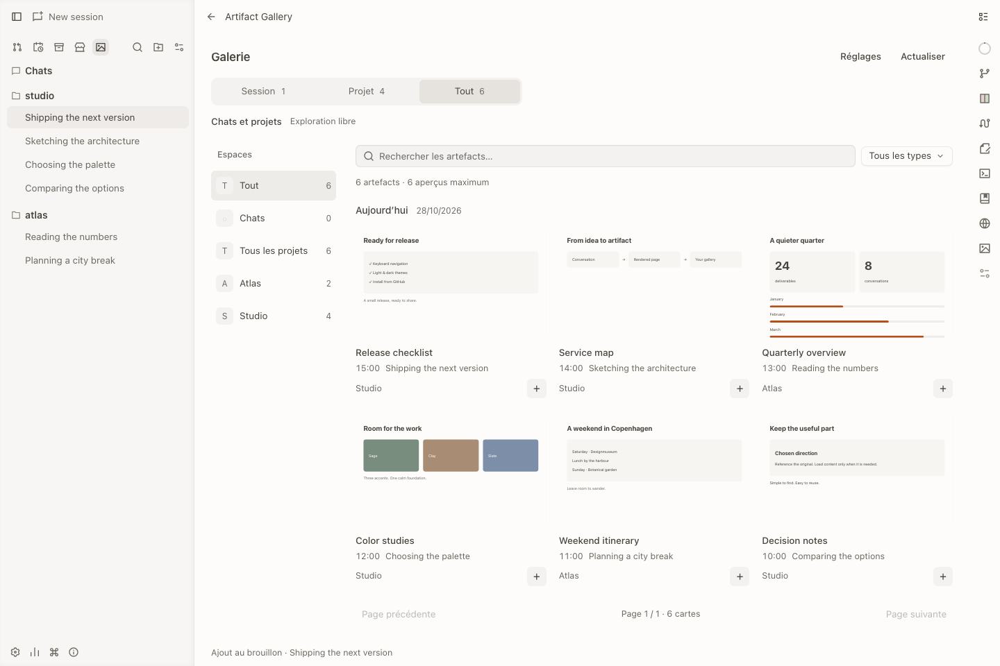

# Un endroit pour les résultats de tes conversations

Artifact Gallery est une extension locale d’OpenChamber pour retrouver les pages,
images, captures et livrables, puis réutiliser leur référence. Elle s’ouvre dans
l’application, en page complète ou en panneau latéral.

## La première minute

1. [Installe l’extension depuis son URL GitHub](installation.md).
2. Ouvre **Artifact Gallery** dans la rangée supérieure gauche, avant la recherche.
3. Choisis **Session**, ou **Tout** pour retrouver les résultats d’autres espaces.
4. Ouvre un artefact et clique sur **Ajouter au message**.

La référence rejoint le brouillon actif, sans envoi automatique. Explorer un autre
projet ne change pas sa destination. Un clic sur la puce rouvre l’artefact.

## Ce que la galerie reconnaît

Les pages `render.page`, captures navigateur, livrables explicitement ouverts,
liens de l’assistant vers des fichiers locaux et pièces jointes image/PDF.
Les modifications de code et sorties d’outils incidentes sont exclues. Les agents
gardent leurs outils habituels, sans étape de publication supplémentaire.

La galerie est un index de sources, **pas une sauvegarde**. Une source déplacée ou
supprimée peut ne plus être prévisualisable.

## Continuer

- [Retrouver un artefact](browse.md) : portées, filtres et dates.
- [Prévisualiser et réutiliser](reuse.md) : formats, références et brouillons.
- [Apparence et langue](appearance.md) : thèmes, préférences et limites du SDK.
- [Confidentialité et limites](privacy.md) : stockage et chargement du contenu.
- [Résoudre un problème](troubleshooting.md).

Les captures publiques montrent le véritable frontend d’OpenChamber sur des données
fictives, dans un environnement isolé. Aucune conversation personnelle n’est publiée.
